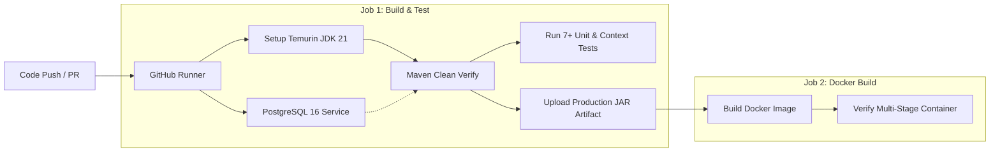

# JobPortal — Spring Boot REST API Backend

[](https://github.com/shailja/job-portal/actions/workflows/ci.yml)


An enterprise-grade, role-based backend service for recruitment and application tracking. Built with **Java 21**, **Spring Boot 3.2**, **Spring Security**, **PostgreSQL**, and fully documented with **OpenAPI 3.0 / Swagger UI**.

---

## 🚀 Key Features

- **Automated CI/CD**: Fully automated GitHub Actions workflow validating builds, testing against PostgreSQL, packaging JARs, and building Docker images.
- **Role-Based Access Control (RBAC)**: Distinct permissions for `ROLE_POSTER` (Recruiters) and `ROLE_SEEKER` (Candidates).
- **100% RESTful Architecture**: Clean JSON request/response payloads, standard HTTP status codes (`201 Created`, `200 OK`, `400 Bad Request`, `401 Unauthorized`, `403 Forbidden`).
- **DTO Layer**: Entity isolation using Data Transfer Objects (`JobPostRequest`, `JobPostResponse`, `ApplicationResponse`, etc.) to prevent over-posting and protect database schemas.
- **Job Ownership**: Jobs are directly linked to the poster who created them; only the owner can manage applicants and delete the listing.
- **Unique Reference Tracking**: Every job application receives a generated tracking reference number (e.g. `APP-2026-4821`).
- **Audit Trails**: Automated timestamps (`createdAt`, `updatedAt`) for both jobs and applications.
- **Interactive Documentation**: SpringDoc OpenAPI 3.0 Swagger UI with built-in HTTP Basic authentication testing.
- **Containerization**: Multi-stage Docker build + Docker Compose with PostgreSQL health checks.

---

## 🛠️ Tech Stack

| Layer | Technology |
|---|---|
| Language & Runtime | Java 21 |
| Framework | Spring Boot 3.2 (Web, Data JPA, Security, Validation) |
| Database | PostgreSQL 16 |
| API Docs & Spec | OpenAPI 3.0 (SpringDoc Swagger UI 2.3.0) |
| Security | Spring Security, BCrypt, HTTP Basic, Role Guards |
| Build Tool | Maven |
| Containerization | Docker & Docker Compose |

---

## 📖 API Documentation & Swagger UI

Once the application is running, open the interactive Swagger UI:

- **Swagger UI**: [http://localhost:8080/swagger-ui.html](http://localhost:8080/swagger-ui.html)

> 💡 **Tip:** You can click the **Authorize** button in Swagger UI and log in using either the pre-seeded poster or seeker credentials below.

---

## 📬 Postman Collection (1-Click Run)

A complete, production-ready Postman collection is included directly in the root directory: **[`JobPortal.postman_collection.json`](./JobPortal.postman_collection.json)**.

### How to Import into Postman:

1. Open Postman and click the **Import** button (top-left).
2. Drag and drop the [`JobPortal.postman_collection.json`](./JobPortal.postman_collection.json) file.
3. All 3 organized folders (**1. Authentication**, **2. Job Seeker**, **3. Job Poster**) will appear immediately!

> ⚡ **No Copy-Pasting Needed:** Every single request comes pre-loaded with **sample JSON bodies**, **URL variables (`{{baseUrl}}`)**, and **pre-configured credentials**. Just click **Send** one by one!

### Pre-Seeded Demo Accounts

The application automatically seeds demo accounts on first launch:

| Role | Email | Password | Allowed Capabilities |
|---|---|---|---|
| **Job Poster** | `poster@jobportal.com` | `password123` | Post jobs, view applicants for own jobs, update application status |
| **Job Seeker** | `seeker@jobportal.com` | `password123` | Browse jobs, submit applications, track application history |

---

## 📡 API Endpoints Specification

**Base Path:** `/api/v1`

### 1. Authentication (`/api/v1/auth`)

| Method | Endpoint | Description | Access |
|---|---|---|---|
| `POST` | `/api/v1/auth/register` | Register new account (`SEEKER` or `POSTER`) | Public |
| `POST` | `/api/v1/auth/login` | Authenticate with email and password | Public |
| `GET` | `/api/v1/auth/me` | Fetch authenticated user profile | Authenticated |

### 2. Jobs (`/api/v1/jobs`)

| Method | Endpoint | Description | Access |
|---|---|---|---|
| `GET` | `/api/v1/jobs` | Retrieve all open job listings | Public |
| `GET` | `/api/v1/jobs/{id}` | Get specific job details by ID | Public |
| `POST` | `/api/v1/jobs` | Create a new job post | `ROLE_POSTER` |
| `GET` | `/api/v1/jobs/my-posted` | List all jobs created by current recruiter | `ROLE_POSTER` |
| `DELETE` | `/api/v1/jobs/{id}` | Delete a job post (owner only) | `ROLE_POSTER` |

### 3. Applications (`/api/v1/applications`)

| Method | Endpoint | Description | Access |
|---|---|---|---|
| `POST` | `/api/v1/jobs/{jobId}/apply` | Apply to a job with candidate details | `ROLE_SEEKER` |
| `GET` | `/api/v1/applications/my` | View all applications submitted by logged-in seeker | `ROLE_SEEKER` |
| `GET` | `/api/v1/jobs/{jobId}/applications` | View all applicants for a job (owner only) | `ROLE_POSTER` |
| `PATCH` | `/api/v1/applications/{id}/status` | Update candidate status (`APPLIED`, `UNDER_REVIEW`, `SHORTLISTED`, `REJECTED`) | `ROLE_POSTER` |
| `GET` | `/api/v1/applications/track/{number}` | Track application status by reference code (`APP-2026-XXXX`) | Public |

---

## 🏃 Run the Application

### Option 1: Docker Compose (Recommended)

Starts both PostgreSQL and the Spring Boot application together:

```bash
docker compose up --build
```

Access Swagger UI at `http://localhost:8080/swagger-ui.html`.  
To stop: `docker compose down` (use `-v` to reset data).

### Option 2: Local Development

1. Ensure PostgreSQL is running and create the database:
   ```bash
   createdb jobportal
   ```
2. Check `src/main/resources/application.properties` credentials:
   ```properties
   spring.datasource.username=postgres
   spring.datasource.password=postgres
   ```
3. Run with Maven:
   ```bash
   ./mvnw spring-boot:run
   ```

---

## 🔄 CI/CD Pipeline (GitHub Actions)

This repository includes a continuous integration and continuous delivery workflow in [`.github/workflows/ci.yml`](./.github/workflows/ci.yml) that triggers on every `push` and `pull_request` to `main` and `master`:



### Key Workflow Highlights:
1. **Real Database Testing**: Spawns an isolated `postgres:16-alpine` service container with built-in health checks (`pg_isready`) on each run.
2. **Automated Test Execution**: Compiles the project and runs all unit & integration tests (`com.jobportal.service.JobServiceTest`, `com.jobportal.JobPortalApplicationTests`).
3. **Artifact Archival**: Retains the compiled production JAR (`target/*.jar`) as a downloadable GitHub Actions artifact for 7 days.
4. **Container Validation**: Verifies that the multi-stage `Dockerfile` packages the production runtime image without errors.

